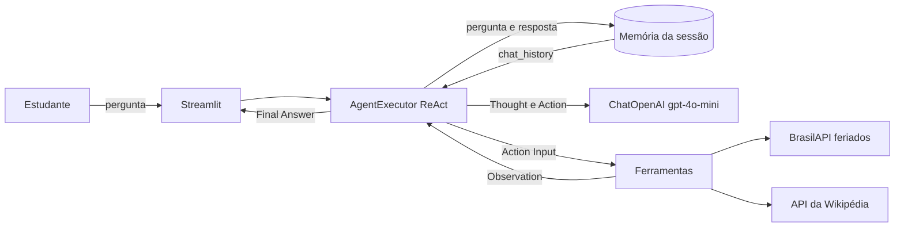

# Mentor de Estudos: agente ReAct com LangChain

Assistente que ajuda estudantes a planejar a preparação para provas. Ele conversa em linguagem natural, calcula o tempo real disponível até a prova, considera os feriados nacionais, divide as horas entre as disciplinas e explica conceitos que precisam ser revisados. A solução combina um agente ReAct, memória conversacional e ferramentas externas, com interface em Streamlit.

## Problema

Montar um cronograma de estudos parece simples, mas exige juntar várias informações espalhadas:

- contar os dias até a prova, descontando folgas semanais e feriados nacionais;
- converter esses dias em horas e dividir as horas entre disciplinas com pesos diferentes;
- refazer todas as contas quando algo muda, como a data da prova ou a rotina;
- procurar a explicação de conceitos esquecidos durante a revisão.

Feito à mão, esse processo envolve calendário, calculadora, planilha e buscas na internet, e precisa ser repetido a cada mudança.

## Objetivo, público-alvo e funcionalidades

**Objetivo:** permitir que o estudante descreva a sua situação em linguagem natural e receba um plano de estudos calculado a partir de dados reais, podendo ajustá-lo ao longo da conversa.

**Público-alvo:** estudantes do ensino médio, vestibulandos (ENEM e outros) e concurseiros.

**Funcionalidades:**

- cálculo dos dias e horas de estudo até a prova, descontando folgas e feriados nacionais;
- consulta aos feriados nacionais de qualquer ano;
- distribuição proporcional das horas entre disciplinas, de acordo com a dificuldade ou a importância de cada uma;
- explicação resumida de conceitos com base na Wikipédia, com a fonte;
- memória da conversa, para que o estudante não precise repetir data da prova, rotina e disciplinas;
- exibição das etapas de raciocínio do agente (Thought, Action e Observation) na interface.

## Solução



### LangChain e LLM

O agente usa o LangChain com o `ChatOpenAI` no modelo `gpt-4o-mini`, escolhido por ser rápido, barato e seguir bem o formato ReAct. A temperatura é zero para que o formato e os cálculos sejam estáveis. O modelo pode ser trocado pela variável `OPENAI_MODEL`.

### Ferramentas

| Nome | Fonte | Função | Entrada |
|------|-------|--------|---------|
| `consultar_feriados` | BrasilAPI | Lista os feriados nacionais de um ano | `2026` |
| `calcular_dias_de_estudo` | BrasilAPI | Conta os dias de estudo entre duas datas, sem feriados e folgas | `2026-11-24; 2026-12-20; domingo` |
| `distribuir_horas` | Cálculo local | Divide as horas entre disciplinas proporcionalmente aos pesos | `60; Matemática=3, Português=2` |
| `pesquisar_wikipedia` | API da Wikipédia | Retorna o resumo e o link do artigo mais relevante | `Estequiometria` |

As ferramentas são criadas com o decorador `@tool` do LangChain. O nome e a descrição de cada uma são enviados ao modelo no prompt ReAct, para que ele saiba quando e como usá-las. Os cálculos ficam nas ferramentas e não no modelo, o que evita números inventados.

### Raciocínio ReAct

O agente é criado com `create_react_agent` e executado pelo `AgentExecutor`. A cada passo o modelo escreve um `Thought`, escolhe uma `Action` e o respectivo `Action Input`. O executor roda a ferramenta e devolve o resultado como `Observation`. O ciclo se repete até o modelo escrever a `Final Answer`, com limite de 8 iterações.

### Memória conversacional

Cada sessão tem o seu próprio histórico de mensagens, enviado ao prompt pelo `MessagesPlaceholder("chat_history")`. Assim, o agente lembra a data da prova, a rotina e as disciplinas já informadas. O histórico guarda as 20 mensagens mais recentes para limitar o tamanho do prompt, e o botão **Nova conversa** apaga a memória.

### Tratamento de erros

- Entradas inválidas nas ferramentas (datas, anos, pesos, dias da semana) viram uma `Observation` explicando o erro, e o agente pode corrigir a entrada.
- Falhas de rede, tempo esgotado e erros HTTP das APIs externas são convertidos em mensagens claras.
- Respostas do modelo fora do formato ReAct são tratadas com `handle_parsing_errors`, que pede ao modelo para corrigir o formato.
- Chave ausente, chave inválida, limite de uso e falhas de conexão da OpenAI aparecem na interface como mensagens amigáveis.
- Quando o limite de iterações é atingido, o estudante recebe uma orientação para reformular a pergunta.

## Estrutura

```
.
├── app.py               # interface em Streamlit
├── agent.py             # agente ReAct, memória e tratamento dos erros da OpenAI
├── prompts.py           # prompt ReAct com o histórico da conversa
├── tools.py             # ferramentas integradas ao LangChain
├── config.py            # variáveis de ambiente e criação do LLM
├── casos_de_uso.py      # execução dos casos de uso com o modelo real
├── tests/               # testes automatizados das ferramentas e do agente
├── evidencias/          # resultados dos testes
├── .env.example
└── requirements.txt
```

## Como executar

Requisitos: Python 3.12 ou superior e uma chave da OpenAI.

```bash
python3 -m venv venv
source venv/bin/activate
pip install -r requirements.txt
cp .env.example .env
```

Edite o arquivo `.env` com a sua chave:

```
OPENAI_API_KEY=sua-chave
OPENAI_MODEL=gpt-4o-mini
```

Inicie a interface:

```bash
streamlit run app.py
```

A aplicação abre em http://localhost:8501. Digite a pergunta no campo de chat e abra o painel **Raciocínio do agente** abaixo de cada resposta para ver as etapas Thought, Action e Observation.

Para rodar os testes automatizados (não precisam de chave nem de internet):

```bash
pytest -v
```

Para executar todos os casos de uso com o modelo real, em uma mesma conversa, e salvar a transcrição completa em `evidencias/casos_de_uso_resultados.md`:

```bash
python casos_de_uso.py
```

## Casos de uso testados

Os casos são executados em sequência na mesma conversa, para validar também a memória. As observações abaixo foram obtidas chamando as ferramentas com as APIs reais em 23/11/2026, com a entrada que o agente precisa enviar em cada caso.

### UC1: tempo disponível até a prova

**Pergunta:** "Minha prova do ENEM é em 2026-12-20. Vou começar a estudar amanhã, 3 horas por dia, e não estudo aos domingos. Quantos dias e quantas horas de estudo eu terei?"

**Ação esperada:** `calcular_dias_de_estudo` com `2026-11-24; 2026-12-20; domingo`.

**Resultado observado:** 27 dias corridos, nenhum feriado nacional no período e 23 dias disponíveis, ou seja, 69 horas de estudo.

### UC2: distribuição das horas usando a memória

**Pergunta:** "Divida essas horas entre Matemática, Redação, Biologia e Química. Matemática é a minha maior dificuldade e Redação vem em seguida."

**Ação esperada:** o agente recupera as 69 horas do histórico, sem perguntar de novo, e chama `distribuir_horas` com pesos maiores para Matemática e Redação, por exemplo `69; Matemática=4, Redação=3, Biologia=2, Química=2`.

**Resultado observado:** Matemática 25,1 h (36%), Redação 18,8 h (27%), Biologia 12,5 h (18%) e Química 12,5 h (18%).

### UC3: explicação de conceito

**Pergunta:** "Na parte de Química eu não lembro o que é estequiometria. Pode me explicar de forma resumida?"

**Ação esperada:** `pesquisar_wikipedia` com `estequiometria`.

**Resultado observado:** resumo do artigo "Estequiometria", baseado nas leis da conservação das massas e das proporções definidas, com o link https://pt.wikipedia.org/wiki/Estequiometria como fonte.

### UC4: feriados e lembrança do contexto

**Pergunta:** "E se a prova fosse adiada para 2027-01-10, mantendo a mesma rotina? Quais feriados entram no período e quantas horas eu teria?"

**Ação esperada:** o agente lembra a data de início, as 3 horas diárias e a folga de domingo, e chama `calcular_dias_de_estudo` com `2026-11-24; 2027-01-10; domingo`. A ferramenta consulta os feriados dos dois anos.

**Resultado observado:** 48 dias corridos, feriados de Natal (25/12/2026) e Confraternização mundial (01/01/2027), 39 dias disponíveis, ou seja, 117 horas de estudo.

### UC5: entrada inválida e recuperação

**Pergunta:** "Na verdade quero dividir 0 horas entre Física e Inglês, pode fazer?"

**Ação esperada:** `distribuir_horas` com `0; Física=1, Inglês=1`.

**Resultado observado:** a ferramenta devolve a observação "O total de horas deve ser maior que zero." O agente não quebra e explica ao estudante que é preciso informar um total de horas positivo.

### Testes automatizados

A pasta `tests/` tem 22 testes, todos aprovados. A saída completa está em `evidencias/testes_automatizados.txt`.

- **Ferramentas:** cálculos de dias, feriados e horas, formatos de data aceitos, validação das entradas e falhas das APIs (tempo esgotado, erro HTTP e busca sem resultado), com as respostas HTTP simuladas.
- **Agente:** usa um modelo falso do LangChain com respostas no formato ReAct para verificar que o ciclo Thought, Action e Observation executa a ferramenta e devolve a observação ao modelo, que o histórico da conversa entra no prompt seguinte, que as sessões têm memórias separadas, que a memória pode ser apagada e que o agente se recupera de uma resposta fora do formato.

## Como o agente facilita o trabalho

Sem o agente, o estudante precisaria:

1. abrir um calendário, contar os dias até a prova e riscar os domingos;
2. procurar a lista de feriados do ano, ou dos dois anos quando a prova é em janeiro, e descontá-los;
3. multiplicar os dias pelas horas diárias;
4. decidir pesos para as disciplinas e calcular a parte de cada uma em uma planilha;
5. buscar a explicação de cada conceito em sites diferentes;
6. refazer todos os passos sempre que a data da prova ou a rotina mudasse.

Com o agente, o estudante descreve a situação em uma frase e recebe o plano calculado. O raciocínio ReAct decide sozinho quais ferramentas chamar e em que ordem: no UC4, por exemplo, uma única pergunta faz o agente reaproveitar a rotina guardada na memória, consultar os feriados de 2026 e 2027 e recalcular as horas. Os números vêm das ferramentas e das APIs, e não da imaginação do modelo, e as etapas ficam visíveis para que o estudante confira como a resposta foi obtida.

A memória é o que torna a conversa natural. O estudante pode dizer "divida essas horas" ou "e se a prova fosse adiada?" sem repetir o contexto, como faria com um tutor. Um chatbot sem ferramentas inventaria os feriados e erraria as contas, e um sistema sem memória exigiria preencher um formulário completo a cada mudança.

Limitações: o agente considera apenas feriados nacionais, sem os estaduais e municipais, e o histórico fica em memória, sendo perdido quando a aplicação é reiniciada.
